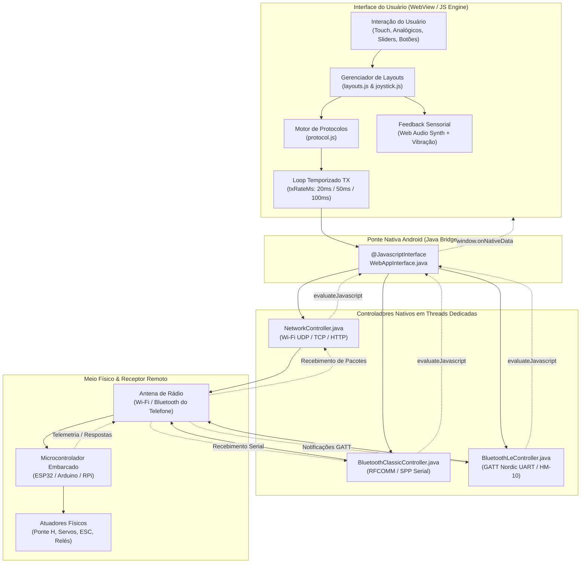
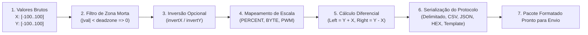
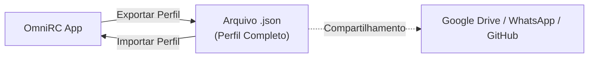
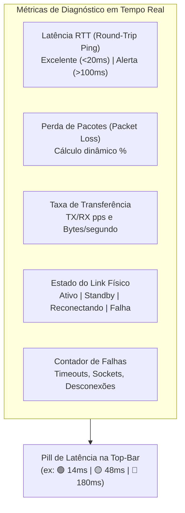
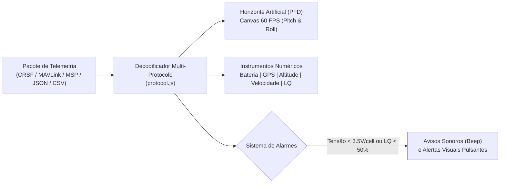
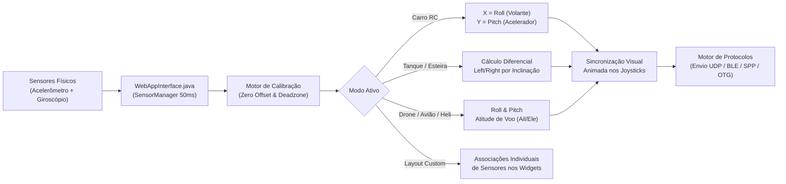
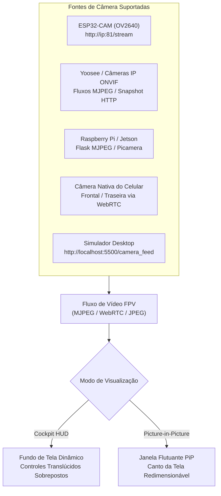
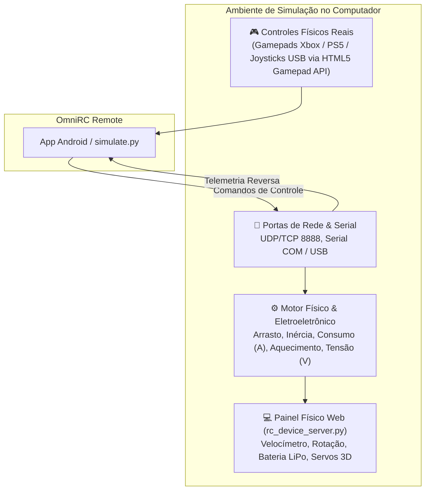

# 🎮 OmniRC Remote - Controle Remoto Universal para Android

Aplicativo Android completo, nativo, compilado e instalável para controle remoto de veículos de rádio controle (RC), robôs móveis, drones, esteiras, braços mecânicos e sistemas embarcados com **ESP32**, **Arduino**, **Raspberry Pi**, **Raspberry Pi Pico W**, **STM32** e **micro:bit**.

O sistema opera com comunicação em tempo real via **Wi-Fi** (UDP, TCP Socket e HTTP) e **Bluetooth** (Classic SPP e Low Energy BLE), dispondo de layouts e protocolos 100% personalizáveis.

---

## 📦 APK Compilado e Instalação Rápida

* **Download Direto:** [OmniRC-Remote.apk (GitHub Releases v1.3.0)](https://github.com/BryamSidoly/OmniRC/releases/download/v1.3.0/OmniRC-Remote.apk)
* **Arquivo no Repositório:** `OmniRC-Remote.apk` (~152 KB)
* **Versão:** v1.3.0 (Build 4)
* **Assinatura:** APK Signature Scheme v1, v2 e v3 (compatível do Android 5.0 Lollipop ao Android 14+)

### Como Instalar no Celular:
1. **Pelo Computador (Wi-Fi Local):** Execute `python serve.py` e abra no navegador do celular o endereço exibido (ex: `http://192.168.x.x:8080/OmniRC-Remote.apk`).
2. **Transferência Direta:** Transfira o arquivo `OmniRC-Remote.apk` via USB, WhatsApp ou Drive e clique em **Instalar** no celular.

---

## 🏗️ Arquitetura Interna do Sistema

O OmniRC utiliza uma arquitetura híbrida de alta performance, unindo uma interface gráfica fluida e responsiva baseada em HTML5/Canvas com controladores nativos em Java em threads dedicadas para garantir baixíssima latência e evitar congelamento de interface (UI blocking):



### Telemetria Bidirecional
Além de enviar comandos, o aplicativo escuta respostas e dados de sensores (temperatura, tensão da bateria, eco de status) transmitidos pelo microcontrolador. O fluxo reverso passa pelas threads nativas e é injetado no DOM através do terminal serial em tempo real (`window.onNativeData`).

---

## 📡 Funcionamento Detalhado das Conexões

O aplicativo suporta 5 canais físicos de comunicação, cada um otimizado para um cenário específico de automação ou rádio controle:

### 1. Wi-Fi UDP (User Datagram Protocol) - *Padrão para RC em Tempo Real*
* **Como opera:** utiliza datagramas puros (`java.net.DatagramSocket` e `DatagramPacket`) na camada de transporte IP.
* **Sem Handshake:** não há estabelecimento de conexão prévia de 3 vias (3-way handshake) nem confirmação de entrega (ACK/NACK).
* **Por que é o ideal para RC:** em veículos rápidos, dados defasados não têm utilidade. Se um pacote com a posição do acelerador se perder, o próximo chegará em 20 ms. O UDP elimina o overhead e o buffer bloqueante do TCP, mantendo latência inferior a **3 ms**.
* **Modo Unicast vs Broadcast:**
  - **Unicast:** envia diretamente ao IP do carrinho (ex: `192.168.4.1` em modo Access Point ou `192.168.1.150` em modo estação).
  - **Broadcast (`255.255.255.255`):** transmite para todos os dispositivos da sub-rede na porta configurada (padrão `8888`), permitindo conectar instantaneamente sem precisar descobrir o IP do microcontrolador.
* **Escuta Paralela:** uma thread em background (`udpReceiveThread`) escuta continuamente mensagens de retorno com buffer de 2048 bytes.

### 2. Wi-Fi TCP Socket (Transmission Control Protocol)
* **Como opera:** estabelece conexão de fluxo contínuo e persistente (`java.net.Socket`) com o servidor do microcontrolador.
* **Garantia de Entrega:** todo byte enviado é confirmado pelo receptor. Ideal para braços robóticos, comandos de configuração e envio de comandos onde nenhuma perda pode ocorrer.
* **Delimitação de Pacotes:** pacotes são transmitidos sequencialmente no `OutputStream` com caracteres terminadores de linha (`\n` ou `\r\n`) para que o microcontrolador possa separá-los facilmente via `readStringUntil('\n')`.

### 3. Wi-Fi HTTP (RESTful GET/POST)
* **Como opera:** dispara requisições assíncronas via `java.net.HttpURLConnection` em pool de threads (`Executors.newCachedThreadPool()`).
* **Ideal para:** servidores web embarcados simples em ESP8266/ESP32 (como `ESPAsyncWebServer`), acionando endpoints como `http://192.168.4.1/cmd?action=FRENTE`.

### 4. Bluetooth Classic SPP (Serial Port Profile / RFCOMM)
* **Como opera:** emula uma porta serial RS-232 transparente sobre a camada RFCOMM do Bluetooth.
* **UUID Padrão:** utiliza o UUID universal de porta serial SPP:  
  `00001101-0000-1000-8000-00805F9B34FB`
* **Compatibilidade:** módulos **HC-05**, **HC-06**, **ESP32 Classic** (via `BluetoothSerial.h`), adaptadores Arduino e robôs educacionais.
* **Ciclo de Conexão:**
  1. O aplicativo lê os dispositivos previamente pareados no Android (`BluetoothAdapter.getBondedDevices()`).
  2. Dispara a conexão em thread assíncrona para não travar a interface (`device.createRfcommSocketToServiceRecord(SPP_UUID)`).
  3. Uma thread de leitura contínua (`readThread`) monitora o `InputStream` para exibir dados de sensores no terminal do app.

### 5. Bluetooth Low Energy (BLE - GATT Central)
* **Como opera:** conecta como dispositivo **Central (Cliente)** a servidores GATT embarcados com perfil de porta serial BLE.
* **Serviços Suportados Automaticamente:**
  - **Nordic UART Service (NUS):** padrão da indústria para microcontroladores modernos:
    - Service UUID: `6E400001-B5A3-F393-E0A9-E50E24DCCA9E`
    - TX Characteristic (Envio): `6E400002-B5A3-F393-E0A9-E50E24DCCA9E` (Write)
    - RX Characteristic (Retorno): `6E400003-B5A3-F393-E0A9-E50E24DCCA9E` (Notify)
  - **Módulos HM-10 / CC2541 / AT-09:**
    - Service UUID: `0000FFE0-0000-1000-8000-00805F9B34FB`
    - Characteristic: `0000FFE1-0000-1000-8000-00805F9B34FB`
* **Negociação de MTU:** solicita negociação de MTU de até 512 bytes (`requestMtu(512)`). Em dispositivos que só aceitam MTU padrão de 20 bytes, o app faz fragmentação segura em chunks.
* **Scanner BLE com RSSI:** localiza dispositivos no ar exibindo o nível de potência de sinal recebido em decibéis (dBm), auxiliando a verificar proximidade.

### 6. Conexão com Adaptador de Rádio via USB / OTG (USB Host Serial) - *Alcance Longo & Baixa Latência*
* **Como opera:** utiliza a API nativa `android.hardware.usb.*` no modo **USB Host**, transformando o smartphone em uma central transmissora física conectada diretamente a um rádio transmissor ou controladora por cabo OTG.
* **Hardware e Módulos de Rádio Suportados:**
  - **Rádios de Telemetria SiK (3DR / Holybro / Readytosky 433 MHz e 915 MHz):** alcance de até 2 a 5 km, comunicação direta com ArduPilot e Pixhawk.
  - **Módulos Transmissores ExpressLRS (ELRS USB):** dongles e módulos USB ELRS 2.4 GHz e 868/915 MHz (RadioMaster Ranger, HappyModel, BetaFPV).
  - **Módulos TBS Crossfire (CRSF USB):** transmissor Long Range conectado via porta USB serial.
  - **Portas USB VCP das Controladoras de Voo:** conexão direta via cabo OTG nas controladoras **Pixhawk (2.4.8, Cube Orange/Yellow)**, **SpeedyBee F405 WING / WING Mini**, **Matek Systems (F405-WING, F722-WING, H743-WING)**, **STM32 Virtual COM Port**, **Arduino** e **ESP32**.
* **Drivers de Chipsets Seriais Nativos Integrados:**
  - **Silicon Labs CP210x** (CP2102, CP2104, CP2105) - usado em rádios SiK, ESP32 e placas de telemetria.
  - **USB CDC-ACM (Communication Device Class)** - padrão USB universal de alta velocidade das placas Pixhawk, Cube, STM32 e Arduino ARM/Leonardo.
  - **WCH CH340 / CH341** - padrão comum em adaptadores e rádios chineses econômicos.
  - **FTDI FT232R / FT2232 / FT4232** - referência industrial e rádios Holybro originais.
  - **Prolific PL2303** - conversores seriais legados.
* **Velocidades Seriais (Baud Rates) Pré-configuradas:**
  - `57600`: Padrão de fábrica dos rádios SiK Telemetry (3DR Radio) e portas TELEM1/TELEM2 do ArduPilot.
  - `115200`: Padrão do ExpressLRS, INAV, Betaflight e IBUS.
  - `420000`: Padrão CRSF High-Speed UART (ExpressLRS e Crossfire).
  - `9600`, `19200`, `38400`, `230400`, `460800`, `921600` (Ultra High-Speed).
* **Hotplug & Detecção em Tempo Real:** o app detecta imediatamente quando um cabo OTG é plugado ou desplugado, recarregando a lista de rádios USB com aviso sonoro e tátil.

---

## ⚙️ Funcionamento Detalhado dos Protocolos

O motor de protocolos (`ProtocolManager`) é o coração do OmniRC, responsável por traduzir toques na tela em comandos formatados:



### 1. Filtro de Zona Morta (Deadzone)
Evita que folgas no analógico ou movimentos mínimos do dedo façam o veículo se mover sozinho em repouso.
* Se $|\text{valor}| < \text{deadzone}$ (configurável de 0% a 20%), o valor é zerado automaticamente antes do envio.

### 2. Mapeamento de Faixa de Valores (Value Range)
Diferentes microcontroladores trabalham com escalas distintas:
* **PERCENT (-100 a +100):** padrão intuitivo para aceleração e esterçamento.
* **BYTE (0 a 255):** escala positiva de 8 bits muito comum em receptores simples. O ponto neutro (centro) é mapeado exatamente em **128**:
  $$\text{Byte} = \text{round}\left(\frac{\text{val} + 100}{200} \times 255\right)$$
* **PWM (-255 a +255):** mapeamento direto para PWM com sinal (usado para alimentar pontes H como L298N, TB6612FNG):
  $$\text{PWM} = \text{round}\left(\frac{\text{val}}{100} \times 255\right)$$

### 3. Tração Diferencial Automática (Differential Steering)
Para carrinhos de esteira, barcos com 2 hélices ou robôs com 2 motores onde não há servo de esterçamento e as curvas são feitas pela diferença de rotação das rodas:
* O app calcula matematicamente no cliente as velocidades dos motores:
  $$\text{Motor Esquerdo} = \text{clamp}(Y + X, -100, 100)$$
  $$\text{Motor Direito} = \text{clamp}(Y - X, -100, 100)$$
* Os valores de `left` e `right` já saem normalizados na escala escolhida e podem ser incluídos no pacote via tags `{left}` e `{right}`.

### 4. Formatos de Serialização Suportados

#### A. Protocolos Gerais de Robótica & IoT:
| Formato | Sintaxe Gerada | Exemplo de Saída | Uso Recomendado |
| :--- | :--- | :--- | :--- |
| **Delimitado (`DELIMITED`)** | `{cmd}:{x}:{y}:{val}\n` | `DRIVE:15:85\n` | ESP32/Arduino com `sscanf()` ou `strtok()` |
| **CSV** | `{cmd},{x},{y},{val}\n` | `DRIVE,15,85\n` | Padrão clássico de telemetria |
| **Texto Simples (`RAW`)** | `{cmd}\n` | `F\n`, `B\n`, `L\n`, `R\n`, `S\n` | Carrinhos básicos de 1 caractere |
| **JSON** | `{"cmd":"...","x":..,"y":..}\n` | `{"cmd":"DRIVE","x":15,"y":85}\n` | ESP32 com biblioteca `ArduinoJson` |
| **Hexadecimal (`HEX`)** | `AA [CMD] [X] [Y] [VAL] 55` | `AA 44 0F 55 00 55` | Protocolos binários industriais ou rádio RF |
| **Template Customizado** | Interpolação textual livre | `M:{left}:{right}\n` ou `RC:{cmd}:{x}:{y}` | Qualquer formato customizado pelo usuário |

#### B. Protocolos Profissionais de Aeromodelismo (Drones, Aviões, Helicópteros):
| Protocolo | Estrutura de Pacote | Resolução / Canais | Controladoras e Receptores Compatíveis |
| :--- | :--- | :--- | :--- |
| **CRSF (Crossfire / ELRS)** | `[0xC8] [24] [0x16] [22B Payload] [CRC8]` | 16 canais (11 bits, 988-2012µs) | ExpressLRS, TBS Crossfire, SpeedyBee, Matek, Radiomaster |
| **SBUS (Futaba / FrSky)** | `[0x0F] [22B Payload 16ch] [Flags] [0x00]` | 16 canais (11 bits, 1000-2000µs) | Receptores FrSky, FlySky, Futaba, RadioMaster ER, Pixhawk |
| **IBUS (FlySky)** | `[0x20 0x40] [14 x uint16 LE] [CRC16]` | 14 canais (uint16 LE 1000-2000µs) | Receptores FlySky FS-iA6B, FS-iA10B, rádios FS-i6/Paladin |
| **MAVLink v1 (ArduPilot)** | `[0xFE] [18] [Seq] [Sys 255] [Comp 190] [Msg 70] [CRC16]` | 8 canais `RC_CHANNELS_OVERRIDE` | Pixhawk (2.4.8, Cube Orange/Yellow), Matek H743, Mission Planner |
| **MSP (MultiWii / INAV)** | `[$M<] [16] [200] [8 x uint16 LE] [CRC]` | 8 canais `MSP_SET_RAW_RC` | INAV (Asas/Aviões), Betaflight (Quads FPV), Cleanflight |

#### Marcadores Suportados no Template Customizado:
* `{cmd}`: Nome do comando (ex: `DRIVE`, `SPEED`, `JOY1`).
* `{x}`: Valor do eixo horizontal mapeado.
* `{y}`: Valor do eixo vertical mapeado.
* `{val}`: Valor escalar (slider ou botão).
* `{left}`: Valor calculado para o motor esquerdo (tração diferencial).
* `{right}`: Valor calculado para o motor direito (tração diferencial).
* `{ch1}` a `{ch6}`: Canais diretos de aeromodelismo em microssegundos (1000 a 2000 µs).
* `\n` ou `\r\n`: Quebras de linha reais.

#### Mapeamento de Canais (Channel Map) & Modo dos Sticks:
* **Ordem dos Canais:**
  - **AETR:** Canal 1 = Aileron, Canal 2 = Elevator, Canal 3 = Throttle, Canal 4 = Rudder (Padrão de mercado ELRS, TBS Crossfire, INAV, Betaflight, MultiWii).
  - **TAER:** Canal 1 = Throttle, Canal 2 = Aileron, Canal 3 = Elevator, Canal 4 = Rudder (Padrão Spektrum / Horizon Hobby).
  - **RETA:** Canal 1 = Rudder, Canal 2 = Elevator, Canal 3 = Throttle, Canal 4 = Aileron.
* **Modo dos Sticks (Transmitter Mode):**
  - **Modo 2 (Mais popular):** Stick Esquerdo = Throttle + Yaw | Stick Direito = Pitch + Roll.
  - **Modo 1:** Stick Esquerdo = Pitch + Yaw | Stick Direito = Throttle + Roll.

### 5. Loop Temporizado de Transmissão (Tx Rate Loop)
Para evitar saturar o buffer serial ou o stack de rede do microcontrolador com centenas de eventos de touch por segundo, o OmniRC utiliza um **loop desacoplado**:
* Taxas configuráveis: **20 ms (50 Hz)**, **50 ms (20 Hz)** ou **100 ms (10 Hz)**.
* Os analógicos apenas atualizam registradores em memória; o timer periódico transmite a foto do estado na frequência exata programada.
* **Benefício de Segurança:** essa cadência contínua é ideal para implementar um temporizador de cão de guarda (**Watchdog**) no microcontrolador.

### 6. Sistema de Parada de Emergência (Fail-Safe & E-Stop)
* **Botão Físico na Barra Superior:** zera imediatamente todos os estados internos do acelerador, volante e esteiras.
* **Disparo Redundante de Corte:** transmite pacotes de parada imediata em múltiplos formatos (`STOP` formatado e `S\n` ASCII).
* **Feedback Visual e Tátil:** pulso de vibração longo de 100 ms, aviso sonoro em onda dente de serra e alerta visual instantâneo na tela.

---

## 🎨 Construtor de Layout Personalizado

No menu de layouts, selecione **🎨 Layout Personalizado**. Você pode montar um painel exclusivo com elementos modulares:

1. **🕹️ Joysticks Analógicos:**
   - Eixos: Ambos (X/Y), Somente Y (Vertical/Acelerador) ou Somente X (Horizontal/Direção).
   - Retorno ao centro com mola ou posição fixa (mantém a posição solta).
   - Telemetria de coordenadas em tempo real (`X:0 Y:0`).
   - Comando associado no protocolo (ex: `JOY1`, `CAMERA_TILT`).

2. **🎚️ Sliders (Controles Deslizantes / Servos / PWM):**
   - Valores mínimo, máximo e valor inicial configuráveis.
   - Envio imediato ao deslizar formatado pelo motor de protocolos.
   - Mostrador numérico em tempo real.

3. **🔘 Botões de Ação Táteis:**
   - Comportamento **Momentâneo** (ativo enquanto segurado) ou **Alternar / Toggle** (liga/desliga iluminado).
   - Comando ao pressionar e comando customizado opcional ao soltar (ex: `TURBO` e `TURBO_OFF`).
   - Cores de destaque: Ciano, Verde, Âmbar, Vermelho e Magenta.
   - Feedback de som sintético Web Audio e vibração nativa.

4. **📐 Espaçadores e Divisores (Paddings):**
   - Criação de divisores estilizados com títulos de seção (ex: "Controles Principais", "Câmera").
   - Alturas de 12px, 24px e 40px.

5. **🧭 Integração com Sensores Inerciais nos Elementos:**
   - Cada joystick ou slider modular pode ser associado individualmente aos sensores de movimento do telefone (Roll/Pitch).
   - Selo visual de status (**🧭 SENSOR ON / OFF**) no editor de elementos.
   - Ajuste fino por elemento de **Ganho/Sensibilidade** (0.2x a 3.0x), **Zona Morta** (0 a 15%) e **Inversão de Eixos**.

6. **Organização em Grid Flexível & Isolamento Estrito de Edição:**
   - **50%:** 2 elementos lado a lado na mesma linha.
   - **100%:** ocupa a largura total da linha.
   - Reordenação (⬆️ subir / ⬇️ descer) e exclusão (🗑️) no menu de gerenciamento.
   - **Isolamento de Layouts:** o editor opera exclusivamente sobre a matriz customizada (`custom_matrix`), protegendo os layouts padrão de fábrica (como Carro RC, Tanque e Drones) contra corrupção acidental.
   - Botões de **Cancelar**, **Fechar (`✕`)** e **Restaurar Padrão** com confirmação de segurança e restauração imediata do preset original.
   - Persistência automática no armazenamento local do Android.

---

## 🕹️ Layouts Pré-configurados Especializados

* **🏎️ Carro RC / Rover:** acelerador vertical, direção horizontal, limitador de potência (10% a 100%) e botões de ação rápida (Farol, Buzina, Turbo, Marchas).
* **🛡️ Tanque / Esteiras:** analógicos verticais independentes para esteira esquerda e direita com botões para giro de 360° no próprio eixo.
* **🎮 Gamepad Console:** dois analógicos de 360° e botões estilo console (A, B, X, Y, L1, R1).
* **🦾 Braço Robótico / Servos:** 4 sliders analógicos para juntas articuladas (Base S1, Ombro S2, Cotovelo S3, Garra S4) e botões de poses pré-salvas (Home, Pick, Drop).
* **🚁 Drone / Multirrotor (Quads, Hexas, FPV Freestyle):**
  - Analógico Esquerdo: Acelerador (Throttle 0..100%, sem mola) & Guinada (Yaw, retorno ao centro).
  - Analógico Direito: Arfagem (Pitch) & Rolagem (Roll) com retorno automático ao centro.
  - Chave de Segurança ARM / DISARM com iluminação pulsante e bloqueio de acelerador a 1000 µs quando desarmado.
  - Seletor de Modos de Voo (CH6): ACRO (taxa manual), ANGLE (auto-nivelamento) e RTH (Return-to-Home por GPS).
  - Botões Rápidos: Buzzer/Beeper localizador sonoro (CH7) e Turtle Mode (Flip Over After Crash, CH8).
  - Monitor HUD dos 4 canais em tempo real (AIL, ELE, THR, RUD em microssegundos).
* **✈️ Asa Fixa / Aeromodelo (Aviões, Asas Voadoras, Planadores):**
  - Chave de Corte de Motor (Motor Cut): trava o acelerador em 1000 µs para segurança em solo e manutenção.
  - Modos de Voo INAV & ArduPlane (CH6): MANUAL (controle direto dos servos), FBWA (Fly-By-Wire A estabilizado), CRUISE e RTH autônomo.
  - Superfícies de Comando: Flaps de 3 posições (0%, 50%, 100% no CH7) e Trem de Pouso Retrátil (CH8, Baixado/Recolhido).
  - Trims Digitais Sub-milimétricos: botões de trim com passos de ajuste (-20 a +20) com bipes tonais para Rudder, Throttle, Elevator e Aileron.
* **🚁 Helicóptero RC CP (Passo Coletivo & Flybarless):**
  - Chave de Segurança Throttle Hold: corte imediato de rotação do rotor para autorrotação de emergência.
  - Condições de Voo (Idle-Up): NORMAL (curva linear), IDLE-1 (80% headspeed para acrobacia) e IDLE-2 (100% headspeed 3D para voo invertido).
  - Controle de Ganho do Giroscópio de Cauda: slider analógico para modo Trava-Cauda AVCS / Heading-Hold (50% a 100%) ou modo Normal.
  - Dual Rate (D/R): alternância instantânea entre 100% SPORT e 70% TAME.
* **📻 Transmissor Universal 16 Canais (Estilo EdgeTX / OpenTX / RadioMaster):**
  - Chaveamento instantâneo entre MODO 1 e MODO 2 (Throttle na esquerda ou direita).
  - Chaves de Chassi: 3 chaves de 3 posições SA (CH5), SB (CH6), SC (CH7) e 1 chave de 2 posições SD (CH8).
  - 2 Potenciômetros Deslizantes S1 (CH9) e S2 (CH10) para gimbals ou flaps proporcionais.
  - Matriz Monitora de 16 Canais: 16 cards com barras de nível gráficas exibindo a posição em microssegundos de cada canal simultaneamente.
* **📟 Terminal Serial & Monitor:** terminal de telemetria bidirecional, envio manual e histórico de mensagens.

## 📱 Barra Superior Otimizada & Menu Lateral Inteligente (Drawer)

Para evitar poluição visual e botões comprimidos em smartphones em modo paisagem, a interface v1.3.0 foi completamente redesenhada:
* **Barra Superior Limpa:** Exibe apenas as informações vitais de voo/corrida — indicador de status da conexão, latência RTT em tempo real, seletor de protocolo, botão de Parada de Emergência (🛑) e o botão do Menu Lateral (`☰`).
* **Menu Lateral com Efeito Vidro Fosco (Glassmorphic Drawer):** Desliza suavemente pela direita, agrupando de forma categorizada todas as telas e ferramentas do ecossistema OmniRC:
  - 📁 **Perfis:** Salvar, exportar e importar configurações completas de veículos.
  - 📶 **Diagnóstico de Conexão:** Monitor de latência, jitter, perda de pacotes e erros.
  - 🛰️ **Telemetria & PFD:** Horizonte artificial (Primary Flight Display), GPS, bateria e alertas.
  - 📹 **Câmera FPV & Gravação:** Streaming em tempo real, transparência e gravação de vídeo.
  - 🧭 **Sensores & Giroscópio:** Calibração inercial e sensibilidade de inclinação.
  - 🎨 **Layouts:** Chaveamento de presets e edição de layouts modulares.
  - 📟 **Terminal Serial:** Inspeção de pacotes brutos TX/RX e envio manual.
  - ℹ️ **Ajuda & Atalhos:** Documentação de uso e atalhos rápidos.

---

## 📁 Perfis Exportáveis e Importáveis (.json universal)

O OmniRC v1.3.0 permite salvar a calibração completa e configurações de múltiplos veículos em arquivos `.json` universais independentes:



### 📦 O Que é Salvo no Perfil:
1. **Identificação do Veículo:** Nome do modelo, tipo (Carro, Drone, Tanque, Avião, Braço, Barco, Custom) e ícone visual.
2. **Layout Completo:** Posição, tipo de widget (joystick, slider, botões, paddings), dimensões em grid, comandos mapeados e associações com sensores inerciais.
3. **Protocolo de Comunicação:** Formato selecionado (CRSF, MAVLink, MSP, SBUS, IBUS, Delimitado, CSV, JSON, Hex ou Template Customizado) e taxa de transmissão (20ms, 50ms, 100ms).
4. **Parâmetros de Conexão:** Meio físico preferencial (Wi-Fi UDP/TCP/HTTP, Bluetooth Classic SPP, Bluetooth Low Energy BLE ou USB-OTG), IPs, portas e taxa de baud.
5. **Calibração de Sensores:** Offsets de zero, sensibilidade, zona morta e inversão de eixos.
6. **Limiares de Telemetria:** Tensões de corte de bateria, limite de RSSI e alertas de altitude.

* **Gerenciamento sem Complicações:**
  - 💾 **Salvar Atual:** Grava o estado corrente no armazenamento local do Android.
  - 📤 **Exportar Perfil:** Baixa o arquivo `.json` gerado para compartilhamento com amigos ou backup.
  - 📥 **Importar Perfil:** Carrega qualquer arquivo `.json` válido com validação automática de esquema e restauração instantânea de controles e conexões.

---

## 📶 Diagnóstico de Conexão em Tempo Real

Monitore a saúde do link de rádio controle e telemetria em tempo real através do painel de diagnóstico (`#modal-diag`):



### 🔬 Recursos do Módulo de Diagnóstico:
* **Latência RTT Bidirecional (Ping):** Mede o tempo exato decorrido entre o envio de um comando e a confirmação/eco recebida do microcontrolador em milissegundos.
* **Perda de Pacotes (Packet Loss):** Monitora a sequência contínua de pacotes esperados vs recebidos, calculando a taxa percentual de perda em janelas móveis de tempo.
* **Taxas de Envio e Recepção (Throughput):** Mede o consumo de largura de banda em pacotes por segundo (`pps`) e bytes por segundo (`B/s`), permitindo identificar saturação de canal ou interferência eletromagnética (RF EMI).
* **Estado da Conexão:** Notifica instantaneamente quedas de conexão antes que o veículo perca o controle.
* **Contador de Erros & Reset:** Exibe o número acumulado de falhas de comunicação, retransmissões e erros de parser, com botão de zerar estatísticas para calibração de bancada.
* **Suporte Universal:** Opera de forma transparente em **todos os modos de operação** (Wi-Fi UDP, TCP, BLE, Bluetooth SPP e USB Serial).

---

## 🛰️ Telemetria Avançada & Painel de Voo PFD (Primary Flight Display)

Inspirado nas estações de solo profissionais e nos visores EdgeTX / OpenTX, o OmniRC v1.3.0 incorpora um painel de instrumentos aeronáuticos completos com horizonte artificial de alta performance:



### 🛩️ Instrumentos Integrados:
1. **Horizonte Artificial (Artificial Horizon Canvas):** Renderiza dinamicamente a atitude da aeronave/drone em tempo real com linhas de graduação de arfagem (*pitch ladder*) e marcador de ângulo de inclinação (*roll bank scale*).
2. **Monitor de Bateria:** Exibe a tensão total da bateria (ex: `12.4V`), barra gráfica de carga percentual e estimativa de número de células LiPo (1S a 6S).
3. **Navegação GPS:**
   - Número de satélites visíveis e sincronizados (com indicador de Fix: *No Fix*, *2D*, *3D*, *DGPS*).
   - Coordenadas geográficas em tempo real (Latitude e Longitude).
   - Indicador de bússola / proa magnética (*Heading* em graus).
4. **Altitude & Velocidade:**
   - Altitude barométrica ou GPS em metros com indicador de taxa de subida/descida (Variômetro / *Climb Rate* em m/s).
   - Velocidade em solo (*Ground Speed*) em km/h.
5. **Qualidade do Link de Rádio (Link Quality / RSSI):**
   - Nível de potência recebida em dBm (ex: `-68 dBm`).
   - Porcentagem de qualidade do sinal (LQ 0% a 100%).
6. **Decodificador Flexível de Telemetria:**
   - **Formato Texto / CSV:** `BAT:12.4,ALT:45,SAT:11,SPEED:32`
   - **Formato JSON:** `{"bat":12.4,"alt":45.2,"sats":11,"speed":32.5,"pitch":-5,"roll":12}`
   - **Protocolos Binários:** Decodificação direta de telemetria CRSF (Battery sensor `0x08`, GPS `0x02`), MAVLink (`SYS_STATUS #1`, `GLOBAL_POSITION_INT #33`, `VFR_HUD #74`) e MSP (`MSP_ANALOG`, `MSP_RAW_GPS`).
7. **Alarmes Audiovisuais Configuráveis:**
   - Emite beeps tonais sintetizados e pisca cards em vermelho caso a bateria caia abaixo do limiar crítico ou a qualidade do link caia para zona de perigo.

---

## 🧭 Controle por Sensores do Celular (Acelerômetro, Giroscópio & Tilt Multi-Modo)

O OmniRC transforma o seu smartphone em um volante e manche inercial por movimento utilizando os sensores inerciais físicos (**Acelerômetro e Giroscópio**) do Android com suporte nativo a múltiplos modos de operação veicular:



### 📐 Recursos do Controlador de Sensores:
1. **Acesso Nativo de Baixa Latência:** A camada Java (`WebAppInterface.java`) registra listeners nos sensores inerciais físicos (`TYPE_ACCELEROMETER` e `TYPE_GYROSCOPE`) com taxa contínua de 50 ms despachados diretamente ao JavaScript (`window.onNativeSensorData`).
2. **Fallback Universal:** Caso executado em navegadores web ou simuladores de PC, o motor chaveia automaticamente para a API HTML5 `DeviceOrientationEvent` e `DeviceMotionEvent`.
3. **Calibração de Zero ("Zerar"):** Um botão dedicado grava a postura atual das suas mãos como referência $(0^\circ, 0^\circ)$, permitindo pilotar deitado, sentado à mesa ou segurando o celular em qualquer ângulo com conforto ergonômico.
4. **Filtro de Zona Morta (Deadzone):** Descarta vibrações musculares e micro-tremores (configurável de 2° a 20°).
5. **Multiplicador de Sensibilidade:** Ajustável de $0.2\times$ a $3.0\times$, permitindo controle cirúrgico para veículos velozes ou giro rápido para drift.
6. **Mapeamento Multi-Modo Especializado:**
   - **🏎️ Carro RC / Rover:** Inclinar para os lados esterça o volante ($X$); inclinar para frente/trás modula acelerador e freio ($Y$).
   - **🛡️ Tanque / Robô de Esteiras:** A inclinação inercial é processada matematicamente pelo algoritmo de tração diferencial gerando velocidades proporcionais para as esteiras esquerda e direita.
   - **🚁 Drone / Quadricóptero:** Controla a atitude angular de vôo (Roll e Pitch para Aileron e Elevator), mantendo Throttle e Yaw seguros no stick esquerdo.
   - **✈️ Aeromodelo / Asa Fixa & Helicóptero:** Comandos proporcionais de rolagem e profundor (cíclico e superfícies aerodinâmicas) por inclinação suave do smartphone.
   - **🎨 Layout Personalizado:** Mapeamento granular configurável diretamente nos elementos modulares com badge indicativo.
7. **Sincronização Visual dos Joysticks Virtuais:** Ao utilizar sensores de movimento, o manípulo dos joysticks virtuais se move graficamente na tela em tempo real, acompanhando a inclinação do aparelho e fornecendo feedback visual imediato do curso de comando aplicado.

---

## 📹 Integração com Câmeras FPV, Câmeras IP e Embarcadas

O OmniRC integra transmissão de vídeo em tempo real (FPV - *First Person View*) diretamente na tela de controle, eliminando a necessidade de alternar aplicativos durante a pilotagem.



### 📡 Fontes de Vídeo e Câmeras Compatíveis:
1. **ESP32-CAM (Módulo OV2640):**
   - Stream HTTP MJPEG nativo na porta 81 (ex: `http://192.168.4.1:81/stream` ou `http://192.168.1.150:81/stream`).
   - Suporte a fotos de alta resolução via `/jpg` ou `/capture`.
2. **Câmeras IP / Wi-Fi Residenciais (Yoosee, ICSee, ONVIF, Intelbras, TP-Link):**
   - Transmissão via endpoint HTTP MJPEG local ou bridges RTSP para HTTP/MJPEG (ex: `http://192.168.1.50:8080/videostream.cgi`).
   - Requisições diretas de snapshots JPEG contínuos em alta taxa (`http://192.168.1.50/snapshot.jpg`).
3. **Raspberry Pi / Jetson Nano / PC Linux:**
   - Câmeras Picamera ou Webcams USB via `mjpg-streamer`, `Flask` micro-server ou `OpenCV` (ver exemplo [`examples/raspberry_pi/rpi_rc_car_camera.py`](file:///C:/Users/Bryan/.gemini/antigravity/scratch/OmniRC/examples/raspberry_pi/rpi_rc_car_camera.py)).
4. **Câmera Local do Smartphone (WebRTC):**
   - Ativação instantânea das lentes frontal ou traseira do próprio celular com permissão automática (`CAMERA` nativa do Android no WebView).
   - Perfeito para montar um celular antigo fixado em cima do robô transmitindo o trajeto.
5. **Simulador Desktop (`rc_device_server.py`):**
   - Stream sintético de painel HUD gerado em Python em `http://localhost:5500/camera_feed`.

### 🖥️ Modos de Exibição, Transparência e Gravação de Vídeo:
* **Cockpit HUD / Câmera em Fundo de Tela:** O vídeo preenche integralmente o fundo do aplicativo com os controles, sticks e botões posicionados à frente (`z-index` em camadas), garantindo visão limpa da pista ou voo sem bloquear a visão do piloto.
* **Ajuste de Transparência dos Controles:** Slider contínuo de opacidade (20% a 100%) no modal da câmera e no menu lateral, permitindo controles semi-invisíveis para imersão total FPV ou 100% opacos para máxima legibilidade ao ar livre sob luz solar direta.
* **Janela Flutuante PiP (Picture-in-Picture):** Posiciona a câmera em uma janela redimensionável no canto superior enquanto mantém a área de pilotagem convencional.
* **🎥 Gravação de Vídeo Integrada (.webm):**
  - Motor de gravação nativo baseado na API `MediaRecorder` do navegador/Android WebView.
  - Gravação com áudio opcional e captura direta do stream ou canvas com carimbo de tempo em tempo real.
  - Botão de Iniciar/Parar com badge visual pulsante de gravação ativa (`REC 00:15`) e download automático imediato para a memória do dispositivo ao encerrar.
* **Controles Rápidos:**
  - 🔄 **Espelhar Horizontal:** Inverte o feed da câmera para manter a referência correta ao olhar para trás.
  - ↕️ **Espelhar Vertical:** Corrige a imagem caso o módulo da câmera esteja instalado de cabeça para baixo no chassi do veículo.
  - 📸 **Captura de Tela (Snapshot):** Salva fotos do trajeto instantaneamente com carimbo de data e hora em alta resolução.

---

## 🧪 Ambiente de Testes, Simulação Física & Periféricos Reais

O OmniRC inclui um ecossistema completo de testes para validar seu projeto no PC antes de ligar motores em veículos reais:



* **Simulador Completo com Dashboard Web & Física Avançada (`rc_device_server.py`):**
  ```powershell
  python rc_device_server.py
  ```
  - Abre um painel dinâmico em `http://localhost:5500` com velocímetro, ângulo de direção real, motores girando com inércia, faróis, buzina e 4 servos animados.
  - **Simulação Mecânica & Dinâmica Veicular:** Calcula inércia de massa, atrito de rolamento estático/cinético, aceleração angular e arrasto aerodinâmico.
  - **Simulação Elétrica & Eletrônica:** Estima o consumo instantâneo de corrente em Amperes ($A$), aquecimento térmico dos motores sob carga, descarga e queda de tensão (*voltage sag*) da bateria LiPo com geração automática de pacotes de telemetria reversa para o app.
  - **Suporte a Periféricos Físicos Reais:** Suporta gamepads reais (Xbox, DualShock, joysticks USB) conectados ao PC ou smartphone através da Gamepad API padrão, além de conexão física com placas Arduino/ESP32 reais via porta serial COM.
* **Simulador Web do App (`simulate.py`):** executa o app OmniRC diretamente no navegador do computador (Edge/Chrome/Firefox) com mock completo de todas as APIs nativas do Android (Vibração, Áudio Synth, Sensores de Orientação, Wi-Fi e Bluetooth).
* **Receptor UDP Simples (`mock_receiver.py`):** exibe pacotes UDP decodificados em tempo real diretamente no console do Windows.
* **Depuração Remota via Chrome DevTools:** conecte o smartphone via USB com a opção "Depuração USB" ativada e depure o WebView em tempo real por `chrome://inspect/#devices`.

---

## 💻 Exemplos de Código para Receptores Embarcados

O diretório [`examples/`](file:///C:/Users/Bryan/.gemini/antigravity/scratch/OmniRC/examples) inclui implementações completas, prontas para gravar e testadas para as principais placas de desenvolvimento do mercado, cobrindo C++, Python e MicroPython:

| Plataforma / Placa | Arquivo no Repositório | Protocolo / Meio | Linguagem | Destaques |
| :--- | :--- | :--- | :--- | :--- |
| **ESP32 DevKit** | [`esp32_wifi_udp_car.ino`](file:///C:/Users/Bryan/.gemini/antigravity/scratch/OmniRC/examples/esp32/esp32_wifi_udp_car.ino) | Wi-Fi UDP (8888) | C++ (Arduino) | Fail-Safe Watchdog, Tração Diferencial, Telemetria |
| **ESP32 DevKit** | [`esp32_bluetooth_spp.ino`](file:///C:/Users/Bryan/.gemini/antigravity/scratch/OmniRC/examples/esp32/esp32_bluetooth_spp.ino) | Bluetooth Classic SPP | C++ (Arduino) | Porta Serial RFCOMM sem fio, reconexão rápida |
| **ESP32 DevKit** | [`esp32_ble_uart.ino`](file:///C:/Users/Bryan/.gemini/antigravity/scratch/OmniRC/examples/esp32/esp32_ble_uart.ino) | Bluetooth Low Energy | C++ (BLE NUS) | Padrão Nordic UART Service, ultra baixo consumo |
| **ESP32-CAM (AI-Thinker)**| [`esp32_cam_rc_car.ino`](file:///C:/Users/Bryan/.gemini/antigravity/scratch/OmniRC/examples/esp32-cam/esp32_cam_rc_car.ino) | Wi-Fi UDP + MJPEG | C++ (Arduino) | Stream de vídeo OV2640 (porta 81) + RC (porta 8888) |
| **Arduino Uno / Nano** | [`arduino_bluetooth_l298n.ino`](file:///C:/Users/Bryan/.gemini/antigravity/scratch/OmniRC/examples/arduino/arduino_bluetooth_l298n.ino) | Bluetooth HC-05/06 | C++ (Arduino) | SoftwareSerial, Ponte H L298N, Watchdog milissegundos |
| **Raspberry Pi 3/4/5/Zero 2**| [`rpi_rc_car_camera.py`](file:///C:/Users/Bryan/.gemini/antigravity/scratch/OmniRC/examples/raspberry_pi/rpi_rc_car_camera.py) | Wi-Fi UDP + Flask | Python 3 | Servidor de vídeo FPV MJPEG + Socket UDP em threads |
| **Raspberry Pi Pico W** | [`pico_w_udp_car.py`](file:///C:/Users/Bryan/.gemini/antigravity/scratch/OmniRC/examples/pico_w/pico_w_udp_car.py) | Wi-Fi UDP (8888) | MicroPython | Modo AP ou Station, PWM de motores, não-bloqueante |
| **ESP8266 (NodeMCU / D1)** | [`esp8266_udp_car.ino`](file:///C:/Users/Bryan/.gemini/antigravity/scratch/OmniRC/examples/esp8266/esp8266_udp_car.ino) | Wi-Fi UDP (8888) | C++ (Arduino) | Solução econômica, Fail-Safe, acionamento Ponte H |
| **ESP32 (Asas / Servos / ESC)** | [`crsf_elrs_decoder_esp32.ino`](file:///C:/Users/Bryan/.gemini/antigravity/scratch/OmniRC/examples/flight_controllers/crsf_elrs_decoder_esp32.ino) | CRSF / ELRS (UDP/Serial) | C++ (Arduino) | Decodifica CRSF 16CH 11-bit e aciona servos/ESC PWM diretos |
| **Arduino (Receptores Clássicos)**| [`sbus_decoder_arduino.ino`](file:///C:/Users/Bryan/.gemini/antigravity/scratch/OmniRC/examples/flight_controllers/sbus_decoder_arduino.ino) | SBUS (Serial 25B) | C++ (Arduino) | Decodificador Futaba/FrSky/RadioMaster SBUS com Servo.h |
| **Pixhawk / Cube / ArduPilot** | [`ardupilot_mavlink_esp32.ino`](file:///C:/Users/Bryan/.gemini/antigravity/scratch/OmniRC/examples/flight_controllers/ardupilot_mavlink_esp32.ino) | MAVLink v1 (#70) | C++ (Arduino) | Ponte Wi-Fi UDP / Bluetooth para TELEM1/TELEM2 com Heartbeat |
| **SpeedyBee / Matek (INAV)** | [`inav_betaflight_msp_esp32.ino`](file:///C:/Users/Bryan/.gemini/antigravity/scratch/OmniRC/examples/flight_controllers/inav_betaflight_msp_esp32.ino) | MSP Serial (#200) | C++ (Arduino) | Ponte MSP_SET_RAW_RC para controladoras INAV / Betaflight |

---

### 1. ESP32 com Wi-Fi UDP & Fail-Safe Watchdog ([`esp32_wifi_udp_car.ino`](file:///C:/Users/Bryan/.gemini/antigravity/scratch/OmniRC/examples/esp32/esp32_wifi_udp_car.ino))
Controle via UDP com temporizador de segurança que corta os motores caso o sinal Wi-Fi caia por mais de 500 ms:
```cpp
#include <WiFi.h>
#include <WiFiUdp.h>

const char* ssid     = "OmniRC_Network";
const char* password = "password123";
WiFiUDP udp;
unsigned long lastPacketTime = 0;
const unsigned long WATCHDOG_TIMEOUT_MS = 500;

void setup() {
  Serial.begin(115200);
  WiFi.begin(ssid, password);
  while (WiFi.status() != WL_CONNECTED) delay(250);
  udp.begin(8888); // Porta padrão do OmniRC
  Serial.print("IP do Carrinho: "); Serial.println(WiFi.localIP());
}

void loop() {
  int packetSize = udp.parsePacket();
  if (packetSize) {
    char buf[128];
    int len = udp.read(buf, sizeof(buf) - 1);
    buf[len] = '\0';
    lastPacketTime = millis();

    char cmd[16]; int x = 0, y = 0;
    if (sscanf(buf, "%[^:]:%d:%d", cmd, &x, &y) >= 1) {
      if (strcmp(cmd, "DRIVE") == 0) {
        // x = direção (-100 a +100), y = acelerador (-100 a +100)
        // Aplicar às pontes H dos motores
      } else if (strcmp(cmd, "STOP") == 0) {
        // Parada de emergência imediata
      }
    }
  }
  if (millis() - lastPacketTime > WATCHDOG_TIMEOUT_MS) {
    // Fail-safe: corta motores se perder sinal
  }
}
```

---

### 2. ESP32 com Bluetooth Low Energy (BLE NUS) ([`esp32_ble_uart.ino`](file:///C:/Users/Bryan/.gemini/antigravity/scratch/OmniRC/examples/esp32/esp32_ble_uart.ino))
Implementa o padrão da indústria **Nordic UART Service (NUS)**, permitindo conexão instantânea sem necessidade de pareamento prévio no Android:
* **Service UUID:** `6E400001-B5A3-F393-E0A9-E50E24DCCA9E`
* **RX Characteristic (Recepção de Comandos):** `6E400002-B5A3-F393-E0A9-E50E24DCCA9E`
* **TX Characteristic (Telemetria para o Celular):** `6E400003-B5A3-F393-E0A9-E50E24DCCA9E`

---

### 3. ESP32-CAM com Vídeo FPV + Controle UDP ([`esp32_cam_rc_car.ino`](file:///C:/Users/Bryan/.gemini/antigravity/scratch/OmniRC/examples/esp32-cam/esp32_cam_rc_car.ino))
Transforma uma placa ESP32-CAM AI-Thinker em um carro FPV completo num único microcontrolador:
* **Núcleo 0 (Core 0):** Serve o streaming de vídeo MJPEG do sensor OV2640 na porta HTTP `81` (`/stream`).
* **Núcleo 1 (Core 1):** Processa datagramas UDP de alta velocidade na porta `8888` e aciona a ponte H dos motores.
* No OmniRC: configure a conexão como **Wi-Fi UDP** (IP do ESP32-CAM, porta `8888`) e na barra superior clique em **📹 Câmera** e informe `http://IP_DO_ESP32:81/stream`.

---

### 4. Arduino Uno / Nano com Bluetooth HC-05 & Ponte H L298N ([`arduino_bluetooth_l298n.ino`](file:///C:/Users/Bryan/.gemini/antigravity/scratch/OmniRC/examples/arduino/arduino_bluetooth_l298n.ino))
Solução para o clássico Arduino Uno/Nano utilizando módulo HC-05 na porta serial por software (`SoftwareSerial` pinos 10 e 11) e controle PWM duplo de velocidade nos canais ENA e ENB da ponte H L298N.

---

### 5. Raspberry Pi com Python & Câmera Picamera ([`rpi_rc_car_camera.py`](file:///C:/Users/Bryan/.gemini/antigravity/scratch/OmniRC/examples/raspberry_pi/rpi_rc_car_camera.py))
Script assíncrono em Python 3 para Raspberry Pi 3/4/5 ou Pi Zero 2 W:
* Inicia servidor web Flask leve transmitindo o feed da câmera Picamera ou Webcam USB em formato multipart MJPEG em `http://IP_DA_RPI:5000/stream`.
* Escuta pacotes de controle UDP em thread separada com fail-safe e converte os valores em saídas PWM via biblioteca `gpiozero` ou `RPi.GPIO`.

---

### 6. Raspberry Pi Pico W com MicroPython ([`pico_w_udp_car.py`](file:///C:/Users/Bryan/.gemini/antigravity/scratch/OmniRC/examples/pico_w/pico_w_udp_car.py))
Utiliza o chip RP2040 Wi-Fi rodando MicroPython puro:
* Pode criar sua própria rede Wi-Fi Access Point (`OmniRC_Car`) ou conectar ao seu roteador.
* Socket UDP não-bloqueante (`setblocking(False)`) e controle de velocidade por PWM de 16 bits (`machine.PWM`) com frequência de 20 kHz para evitar ruído acústico nos motores.

---

### 7. ESP8266 NodeMCU / D1 Mini ([`esp8266_udp_car.ino`](file:///C:/Users/Bryan/.gemini/antigravity/scratch/OmniRC/examples/esp8266/esp8266_udp_car.ino))
Projeto de ultra-baixo custo para módulos baseados em ESP8266 (ESP-12E/F) com Wi-Fi UDP e controle direto de pontes H compactas (L9110S, DRV8833 ou L298N).

---

### 8. ESP32 com Decodificador CRSF / ExpressLRS & Servos PWM ([`crsf_elrs_decoder_esp32.ino`](file:///C:/Users/Bryan/.gemini/antigravity/scratch/OmniRC/examples/flight_controllers/crsf_elrs_decoder_esp32.ino))
Recebe quadros CRSF de 26 bytes (padrão ExpressLRS / TBS Crossfire) via Wi-Fi UDP ou Serial/USB-OTG, valida CRC8 DVB-S2 (polinômio `0xD5`), desempacota os 16 canais de 11 bits e aciona diretamente servos analógicos/digitais e ESCs brushless nas GPIOs através da biblioteca `ESP32Servo`. Possui fail-safe automático com corte de motor em 500 ms de perda de sinal.

---

### 9. Arduino com Decodificador SBUS Futaba/FrSky ([`sbus_decoder_arduino.ino`](file:///C:/Users/Bryan/.gemini/antigravity/scratch/OmniRC/examples/flight_controllers/sbus_decoder_arduino.ino))
Para aeromodelos clássicos usando placas Arduino Uno/Nano: decodifica os quadros seriais de 25 bytes do protocolo SBUS recebidos via Bluetooth HC-05/06 ou USB-OTG a 115200 bps e gera pulsos PWM individuais (1000 a 2000 µs) para até 5 servos e ESCs com a biblioteca nativa `Servo.h`.

---

### 10. ESP32 como Ponte MAVLink para ArduPilot & Pixhawk ([`ardupilot_mavlink_esp32.ino`](file:///C:/Users/Bryan/.gemini/antigravity/scratch/OmniRC/examples/flight_controllers/ardupilot_mavlink_esp32.ino))
Atua como rádio de telemetria sem fio conectado à porta TELEM1/TELEM2 (UART a 57600 bps) de controladoras de nível profissional e autônomo (**Pixhawk 2.4.8, Cube Orange, Cube Yellow, Matek H743**):
* Mantém o link GCS ativo enviando pacotes Heartbeat MAVLink v1 (msg #0) a cada 1 segundo.
* Encaminha datagramas UDP recebidos do OmniRC contendo `RC_CHANNELS_OVERRIDE` (msg #70) para os canais de comando do piloto automático.
* Repassa a telemetria reversa enviada pela Pixhawk de volta para o app.

---

### 11. ESP32 como Ponte MSP para SpeedyBee & Matek com INAV / Betaflight ([`inav_betaflight_msp_esp32.ino`](file:///C:/Users/Bryan/.gemini/antigravity/scratch/OmniRC/examples/flight_controllers/inav_betaflight_msp_esp32.ino))
Conecta-se a uma porta UART livre a 115200 bps de controladoras dedicadas de voo (**SpeedyBee F405 WING / WING Mini, Matek Systems F405-WING, F722-WING**):
* Recebe pacotes de rádio controle binários `MSP_SET_RAW_RC` (comando 200 do protocolo MultiWii Serial Protocol v1) enviados pelo OmniRC via Wi-Fi UDP ou Bluetooth.
* Controla diretamente Superfícies de Voo (Roll, Pitch, Yaw), Acelerador (Throttle), Chave de Arme (AUX1/ARM), Modos de Voo (AUX2: Acro, Angle, RTH), Flaps/Beeper (AUX3) e Trem/Turtle (AUX4).

---

## 🛠️ Como Recompilar o APK

Para recompilar o projeto após qualquer alteração:
```powershell
python build.py
```
O script executa automaticamente AAPT2, vinculação com o `android.jar`, compilação Java com javac, conversão Dalvik DEX com D8 e assinatura v1/v2/v3 em menos de 1 segundo.

---

## 📜 Histórico de Versões & Notas de Lançamento

### 🚀 v1.3.0 (Build 4) - *Release Atual*
* **📱 Menu Lateral Inteligente (Drawer Glassmorphic):** Redesenho da navegação superior para evitar aglomeração de botões em modo paisagem. Barra de ferramentas limpa com botão hambúrguer deslizante para todas as telas secundárias.
* **📶 Diagnóstico de Conexão em Tempo Real:** Monitoramento dinâmico de latência RTT (Ping), jitter, perda de pacotes (Packet Loss %), taxa de transferência (pps e B/s), estado do link e contadores de erros de socket e timeout.
* **📁 Perfis Exportáveis e Importáveis (.json universal):** Salve e compartilhe configurações completas de veículos, layouts personalizados, calibrações de sensores, conexões e limiares de alarme com importação/exportação com 1 clique.
* **🛰️ Telemetria Avançada & Painel de Voo PFD (Primary Flight Display):** Horizonte artificial com atitude angular (Pitch/Roll), altímetro, velocímetro, status de satélites GPS, medidor de tensão e porcentagem de bateria LiPo, qualidade do link de rádio (LQ/RSSI) e alarmes audiovisuais.
* **📹 Câmera FPV em Fundo de Tela, Opacidade & Gravação de Vídeo:**
  - Modo Cockpit com fluxo de vídeo ocupando todo o fundo por trás dos joysticks.
  - Controle deslizante de transparência dos controles (20% a 100%).
  - Gravação de vídeo nativa integrada (`.webm`) com badge de tempo e salvamento direto.
* **🧭 Controle por Sensores Multi-Modo:**
  - Suporte completo a Carro RC, Tanque (tração diferencial por inclinação), Drones, Aeromodelos e Helicópteros (atitude angular).
  - Correção na sincronização visual: os manípulos dos joysticks virtuais agora se movem e acompanham a inclinação física do smartphone em tempo real.
* **🎨 Layout Personalizado Modular com Sensores:**
  - Associação direta de elementos modulares com eixos inerciais e selo visual (`🧭 SENSOR ON`).
  - Isolamento estrito de edição: garantia de que alterações, fechar (`✕`), cancelar ou restaurar padrão afetem apenas a matriz personalizada, protegendo os layouts padrão de fábrica contra corrupção.
* **🎮 Simulador com Física Avançada & Periféricos Reais:**
  - `rc_device_server.py` com modelo físico, dinâmico, mecânico, elétrico e térmico em tempo real.
  - Suporte a controles físicos reais (joysticks USB e gamepads Bluetooth) através da API Gamepad no navegador e simulador.

---

### 🚁 v1.2.0 (Build 3)
* **✈️ Presets de Aeromodelismo:** Drones/Multirrotores, Aviões/Asas Fixas (INAV/ArduPlane), Helicópteros CP e Transmissor Universal de 16 Canais estilo EdgeTX/OpenTX.
* **📡 Protocolos Profissionais:** Adição de CRSF (ExpressLRS / TBS Crossfire), SBUS (Futaba/FrSky), IBUS (FlySky), MAVLink v1 (ArduPilot/Pixhawk) e MSP (INAV/Betaflight).
* **🔌 Conexão USB-OTG Serial:** Drivers nativos para chipsets CP210x, CDC-ACM, CH340, FTDI e PL2303 com detecção de plug/unplug em tempo real.
* **📱 Tela Paisagem & Assinatura Release Key:** Orientação horizontal forçada e correção de instalação em aparelhos modernos (Galaxy A56, Android 14/15).

---

### 🏎️ v1.1.0 (Build 2)
* **🎨 Construtor de Layout Personalizado:** Criação modular de analógicos, botões e sliders com persistência local.
* **🧭 Controle por Giroscópio / Acelerômetro:** Pilotagem inercial por inclinação do aparelho com calibração de zero.
* **📹 Streaming de Câmera FPV:** Suporte a feeds MJPEG de ESP32-CAM e câmeras IP locais com snapshot e espelhamento.

---

### 📦 v1.0.0 (Build 1)
* **Lançamento Inicial:** Comunicação Wi-Fi (UDP, TCP, HTTP) e Bluetooth (Classic SPP e BLE GATT).
* Layouts básicos de Carro RC e Terminal Serial.
